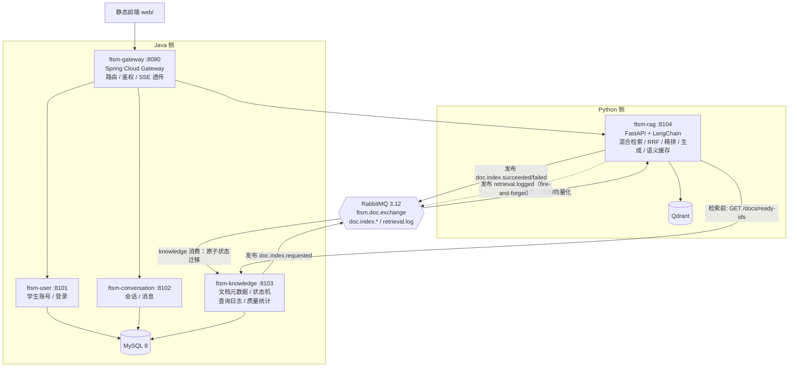

# FTSM-RAG 架构升级改造模板（毕业设计版：微服务 + Java 双栈 + MQ）

> 对齐目标：tjxt-javaai02 的「Java 管业务与数据权威 + Python 管 AI + RabbitMQ 事件解耦」模式
> 定位修正：本项目按**毕业设计**评估——架构演示本身就是交付物，拆微服务成立
> 生成时间：2026-10-08（v3，替代 v2）｜ `【已核实】` = 已读代码；`【推断】` = 未实测

---

## 0. 一句话结论

**拆，但要按 tjxt 已验证的切法拆：RAG 检索链路留在 Python（那是你的核心资产），Java 承接用户/会话/知识库元数据三个业务服务 + 网关，RabbitMQ 解耦文档索引流水线与查询日志回写。** 预估 2.5–3.5 周兼职进度；第一代价是放弃桌面 EXE 打包，必须先接受。

## 1. 现状盘点【已核实】

### 1.1 分支矩阵（Step 0 仍要先做）

| 分支 | rag_service.py | BM25/RRF | gte-rerank-v2 | 评测脚本 | 判定 |
|---|---|---|---|---|---|
| `main` / 当前 HEAD | 72 行，纯向量（Chroma） | ✗ | ✗ | ✗ | 落后 |
| `Qdrant` | 完整 | ✗ | ✓ | ✓ | 半成品 |
| `FTSM_Revised` / `feat/qdrant-migration` | 完整三段式 | ✓（12+12→RRF） | ✓（top6） | ✓ | **最全，以此为准** |

**P0**：HEAD 的 README 声称三段式检索 + 评测套件，但 HEAD 代码是纯向量 + 无评测脚本——先收敛分支，再动架构，否则改造落在错误基线上。

### 1.2 资产清单（决定"什么留 Python、什么给 Java"）

| 现有模块 | 处置 |
|---|---|
| 混合检索 + RRF + gte-rerank-v2（`FTSM_Revised` 版） | **留 Python** —— 核心差异化，重写为 Java 是负优化 |
| 语义缓存 cosine 0.92（`utils/semantic_cache.py`） | **留 Python** —— 与检索同进程才有意义 |
| ReAct agent（`agent/react_agent.py`） | **留 Python** —— LangChain 生态 |
| 评测脚本 evaluate_rag / evaluate_cache / encoding_health | **留 Python**，最后一步指向新链路 |
| 学生账号（PBKDF2 200k，`web_app.py` 内联） | **迁 Java** —— 鉴权是典型业务边界 |
| 会话存储 `conversations/*.json` | **迁 Java + MySQL** —— 文件存储撑不起多服务 |
| 知识库 manifest + 索引状态 | **迁 Java + MySQL** —— 状态机/查询日志/权威过滤的落点 |
| 静态前端 `web/` | 保留，baseURL 指向网关 |

## 2. 前提决策（改造前必须接受）

| 决策 | 内容 | 理由 |
|---|---|---|
| 放弃桌面 EXE | PyInstaller / Tauri 打包链路冻结归档，交付改为 `docker-compose up` | 微服务与单文件 EXE 不可兼得；毕业设计不需要 EXE |
| 上 MySQL 8 | 替代全部 JSON 文件存储 | 多服务共享状态必须有权威 DB |
| 服务间引入 RabbitMQ 3.12 | 与 tjxt 同版本同用法：**事件通知 + 幂等消费**，不做 RPC 化滥用 | 文档索引是天然异步任务，对齐 tjxt 支付通知模式 |
| 注册中心用 Nacos | 与 tjxt 同栈，复用运维经验 | 也可降级为纯网关静态路由，见 §5 Step 1 |

## 3. 目标架构



**权威边界（答辩核心叙事，对齐 tjxt）**：`ftsm-knowledge` 是文档状态与查询日志的唯一权威；`ftsm-rag` 每次检索前向它取 READY 文档清单做权威过滤。Java 永远不碰向量，Python 永远不写业务状态；**跨服务状态变更只走 MQ 事件，不做服务间直改**——这正是 tjxt 里"支付成功经 `PAY_EXCHANGE` → `trade.pay.success.queue` → 原子状态迁移"的同款模式。

### 服务拆分映射表

| 目标服务 | 技术栈 | 承接现有代码 | 端口 |
|---|---|---|---|
| ftsm-gateway | Spring Cloud Gateway | 新写（鉴权过滤器迁自 `web_app.py` 的 cookie 校验） | 8080 |
| ftsm-user | Spring Boot 3 + MyBatis-Plus | `student_accounts.json` + PBKDF2 逻辑原样迁 | 8101 |
| ftsm-conversation | Spring Boot 3 + MyBatis-Plus | `conversations/*.json` 读写逻辑迁为 CRUD | 8102 |
| ftsm-knowledge | Spring Boot 3 + MyBatis-Plus | manifest 逻辑 + 新增状态机/日志/质量接口 | 8103 |
| ftsm-rag | FastAPI（现栈不动） | `rag/` + `agent/` + `model/` + `utils/` | 8104 |

## 4. 原模板的 4 个工程件 → 落点调整

| # | 工程件 | 原单体方案落点 | 微服务版落点 |
|---|---|---|---|
| 1 | per-doc 状态机 INDEXING→READY/FAILED | manifest JSON | **ftsm-knowledge** `doc` 表 + 状态字段 |
| 2 | 双门限拒答（dense≥0.6 / BM25 coverage≥0.3） | `rag/gates.py` | **ftsm-rag** 内（不变） |
| 3 | 查询日志 + `/api/retrieval/quality` | JSONL 追加 | **ftsm-knowledge** `query_log` 表，rag 经 MQ 发布 `retrieval.logged` 事件异步落库 |
| 4 | 权威源过滤 | 本地 manifest 校验 | **ftsm-rag** 调 knowledge 的 `GET /docs/ready-ids`（同步 HTTP，读操作不走 MQ） |

### 4.1 MQ 事件契约（对齐 tjxt 的 `PAY_EXCHANGE` / `trade.pay.success.queue` 模式）

| 项 | 值 | tjxt 对应物 |
|---|---|---|
| Exchange | `ftsm.doc.exchange`（topic） | `PAY_EXCHANGE` |
| 队列 A | `doc.index.request.queue` ← routing key `doc.index.requested` | — |
| 队列 B | `doc.index.result.queue` ← `doc.index.succeeded` / `doc.index.failed` | `trade.pay.success.queue` |
| 队列 C | `retrieval.log.queue` ← `retrieval.logged` | — |
| 死信 | `doc.index.dlq`（重试 3 次后入队，控制台可见） | — |
| 生产者 A / 消费者 B | ftsm-knowledge | tj-pay → tj-trade |
| 消费者 A / 生产者 B | ftsm-rag | — |
| 消息体 | `{docId, filePath?, chunkIds?, error?, ts}` | `{payOrderNo, ...}` |
| 幂等 | 消费侧原子状态迁移：`UPDATE doc SET status=? WHERE id=? AND status='INDEXING'`，重复消息自然 no-op | tjxt 的 `WHERE status IN (...)` 原子迁移 |
| 客户端 | Java `spring-boot-starter-amqp`（手动 ack）；Python `aio-pika`（处理完再 ack） | `RabbitMQ` + `@RabbitListener` |

**事件流（对照现状代码）**：上传 → knowledge 建 `INDEXING` 记录并发布 `doc.index.requested` → rag 消费执行切块/向量化（现 `vector_store.py:load_document` 的同步逻辑改为事件驱动）→ 成功发 `succeeded` / 失败发 `failed`（保留 chunk_ids 供清理，对齐 tjxt `markFailed` 语义）→ knowledge 消费做原子状态迁移。原 `web_app.py` 的 `_TRAINING_STATE` 内存轮询机制整体废弃，改由 `/api/documents` 读库展示状态。

## 5. 迁移步骤（顺序执行）

### Step 0：分支收敛【P0，0.5–1h】
```bash
git diff FTSM_Revised feat/qdrant-migration -- rag/ scripts/ config/   # 选基线
git checkout main && git merge feat/qdrant-migration --no-ff
grep -rn "BM25Okapi" rag/ && grep -rn "TextReRank" rag/ && ls scripts/evaluate_rag.py  # 自检
```

### Step 1：仓库分层 + 基础设施【2–3h】
```
FTSM-RAG/
├── ftsm-java/            # Maven 多模块: gateway / user / conversation / knowledge
├── rag-python/           # 现 rag/ agent/ model/ utils/ web_app.py 裁剪迁入
├── web/                  # 前端不动
├── docker-compose.yml    # mysql + rabbitmq(3.12, management 端口 15672) + nacos(可选) + qdrant + 5 服务
└── docs/
```
Nacos 用 tjxt 同款（2.4）；若想减负，可先用 Gateway 静态路由，Nacos 留作二期——答辩讲"预留注册发现"即可。

### Step 2：ftsm-user【0.5–1 天】
`student_accounts.json` → MySQL `student` 表；PBKDF2(200k) 校验逻辑原样移植（Java 用 `PBKDF2WithHMACSHA256`）；登录签发与现在同格式的 session cookie，网关透传。

### Step 3：ftsm-conversation【0.5–1 天】
`conversations/*.json` → `conversation` / `message` 两张表；现有 REST 契约（列表/新建/读取/删除/清空）保持不变，前端零改动。

### Step 4：ftsm-knowledge【1.5–2 天，工程件 1/3 落此】
manifest → `doc`（含 `status` / `error` / `content_hash` / `chunk_ids`）与 `query_log` 两张表；
同步接口：`GET /docs/ready-ids`、`GET /retrieval/quality`；
MQ 侧：声明 `ftsm.doc.exchange` 与三条队列（§4.1）；发布 `doc.index.requested`；
消费 `doc.index.succeeded/failed` 做**原子状态迁移**，消费 `retrieval.logged` 落 `query_log`。

### Step 5：ftsm-rag 改造【1.5–2 天，工程件 2/4 落此】
- 索引链路改事件驱动：aio-pika 消费 `doc.index.requested` → 执行切块/向量化（现 `vector_store.py:load_document` 的同步逻辑原样搬入消费者）→ 成功发布 `doc.index.succeeded` / 失败发布 `doc.index.failed`（带 chunk_ids 供清理，重试 3 次后入死信）
- `retriever_docs()` 加双门限拒答 + 检索后按 `ready-ids` 过滤
- 每次检索结束发布 `retrieval.logged`（fire-and-forget，MQ 不可达时降级打日志，不阻塞主链路）

### Step 6：gateway 聚合【0.5–1 天】
路由表：`/api/users/**`→8101、`/api/conversations/**`→8102、`/api/documents/**`+`/api/retrieval/**`→8103、`/api/chat/**`→8104。
**风险点【推断】**：`/api/chat` 是 SSE 流式——Spring Cloud Gateway 默认支持流式响应，但需验证未开启响应缓冲；若用 Nginx 前置还需 `proxy_buffering off`。此步必须实测一条完整流式回答。

### Step 7：评测与验收收尾【0.5 天】
`evaluate_rag.py` 指向新链路重跑一遍基线，产出改造前后对比（这个对比本身就是答辩素材）。

## 6. 风险与诚实清单

| 风险 | 说明 | 处置 |
|---|---|---|
| 工作量 | 全程 ≈ 2.5–3.5 周兼职进度 | Step 0–1 先行，之后每个服务独立可停 |
| MQ 消息丢失 | 发布方未开 confirm、消费方先 ack 后处理都会丢 | Java 侧开 publisher confirm；两侧均处理完再手动 ack；死信队列兜底 |
| 幂等缺口 | 消息重复投递导致重复索引/重复日志 | 状态机原子迁移（`WHERE status='INDEXING'`）+ 消费前查重 |
| SSE 透传 | 网关层流式需实测 | Step 6 专项验证 |
| 双栈联调成本 | 两个运行时、两套依赖 + MQ | docker-compose 一键起；事件契约（§4.1）先写死再实现 |
| EXE 用户丢失 | 已分发的桌面版与新版并存 | 归档 `desktop/`，README 注明两代交付形态 |
| 定位重叠 tjxt | 双栈叙事趋同 | 差异化见 §9 |

## 7. 验收清单

- [ ] `docker-compose up` 一条命令起全栈，`/api/health` 聚合各服务状态
- [ ] 登录走 ftsm-user（MySQL），旧 `student_accounts.json` 数据可导入
- [ ] 上传文档 → knowledge 显示 per-doc INDEXING→READY；断网制造失败 → FAILED + error
- [ ] 索引走 MQ 端到端：RabbitMQ 管理台（:15672）可见 exchange / 队列 / 消息流；**演示杀手锏**——kill 掉 ftsm-rag 后消息积压，重启服务自动消费完成索引
- [ ] 幂等：重复投递同一条 `doc.index.requested`，不重复建向量、状态不突变（原子迁移生效）
- [ ] 死信路径：人为制造索引失败重试 3 次，消息落入 `doc.index.dlq` 且 doc 状态为 FAILED
- [ ] 域外问题返回拒答且 query_log `hit=false`；dashboard 展示 hit_rate / avg_latency
- [ ] 删除文档后其 chunk 不再出现在检索结果（权威过滤生效）
- [ ] `/api/chat` 流式回答逐字输出无缓冲卡顿
- [ ] `evaluate_rag.py` 在新链路产出 MRR/P@K/R@K 报告，与单体版对比数据留存
- [ ] README 每条 Feature 都能 grep 到实现，且只描述 main 分支

## 8. 答辩 / 面试话术边界

**为什么毕业设计要拆微服务（标准答案）**：单学院知识库 → 多学院/多校扩展是明确演进方向，用户、会话、知识库的边界天然独立；双栈隔离让 AI 链路（依赖重、迭代快）不拖累业务链路（稳定、事务性）。—— 这个答案同时是真实工程判断，不是包装。

**为什么用 MQ（标准答案）**：文档索引是秒级到分钟级的异步任务，同步 HTTP 会占住上传请求且失败无法可靠重试；事件驱动让失败可重试、状态可观测、消费可幂等。查询日志走 fire-and-forget 事件，检索主链路零阻塞。—— 与 tjxt 的支付成功通知是同一类问题（跨服务状态变更的事件化）。

**可以写**：双栈微服务（Spring Cloud Gateway + 3 个 Java 业务服务 + FastAPI RAG 服务）、RabbitMQ 事件驱动索引流水线（幂等消费 + 死信兜底）、混合检索 + cross-encoder 精排、语义缓存、文档状态机、双门限拒答、权威数据边界、可执行评测与改造前后对比。

**不要写**："生产级""高并发""支撑 XX QPS"——毕业设计没有真实流量，主动说明比被问出来强。

## 9. 三项目定位（改造完成后的格局）

| 项目 | 一句话定位 | 面试分工 |
|---|---|---|
| **FTSM-RAG**（本模板完成后） | 双栈微服务 + RAG 全链路深度（精排/缓存/评测/状态机）+ 真实用户场景（FTSM 学生） | **RAG 与架构双主打** |
| tjxt-javaai02 | 15 服务规模 + 交易/支付业务复杂度 + 双栈边界 | 讲规模与业务工程化 |
| P1 / P2（Java RAG 两套） | Java 框架等价性对比（Spring AI vs LangChain4j） | 讲选型与取舍 |
